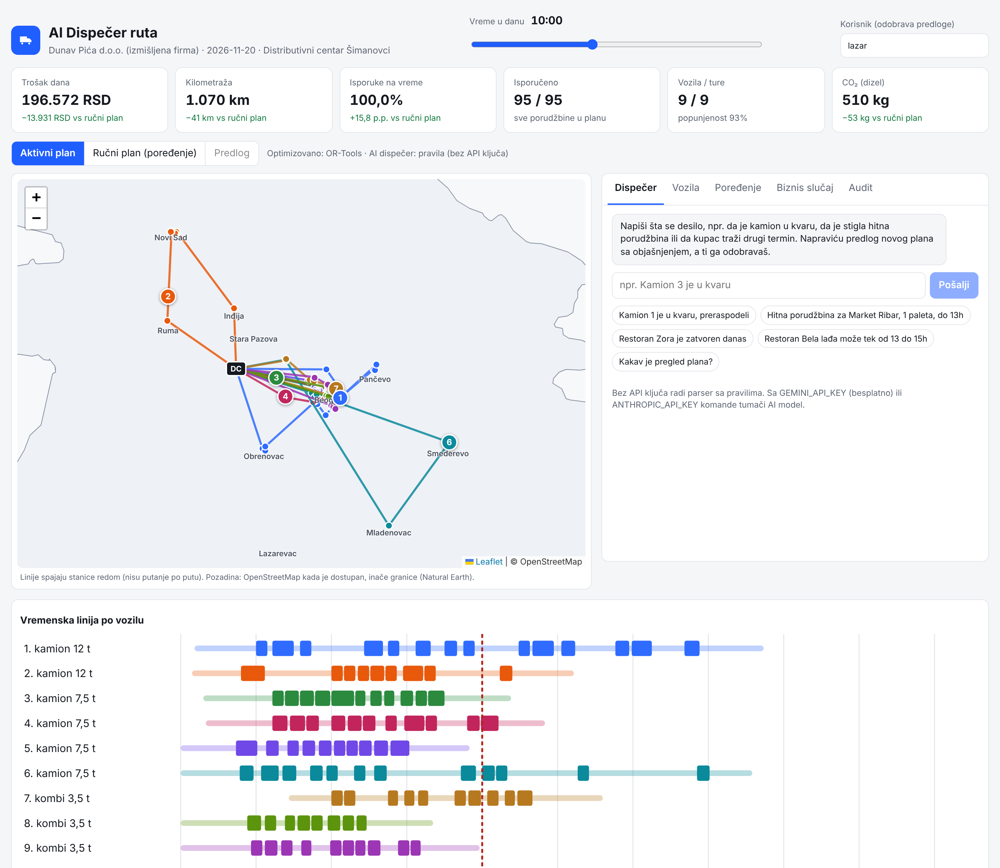
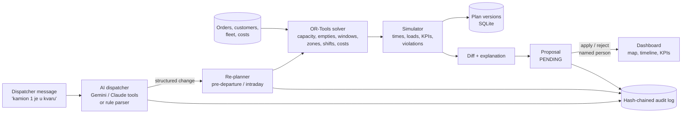
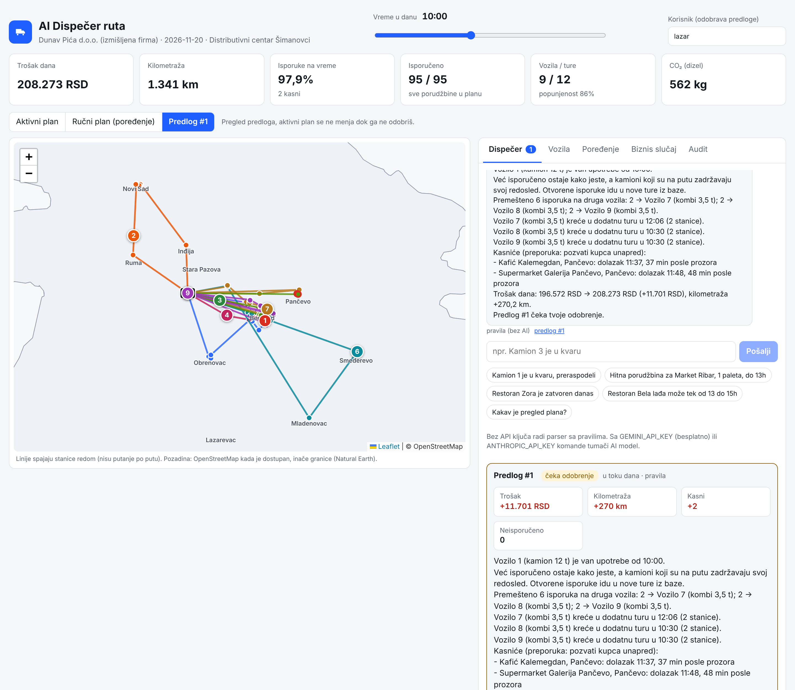
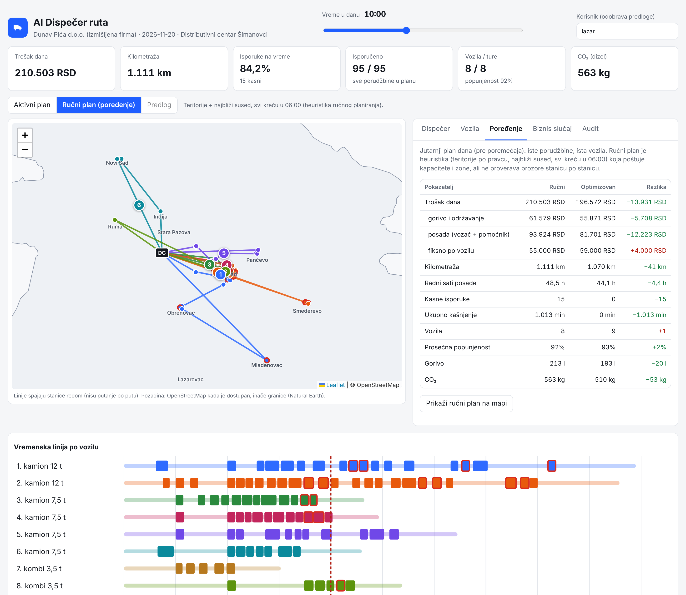
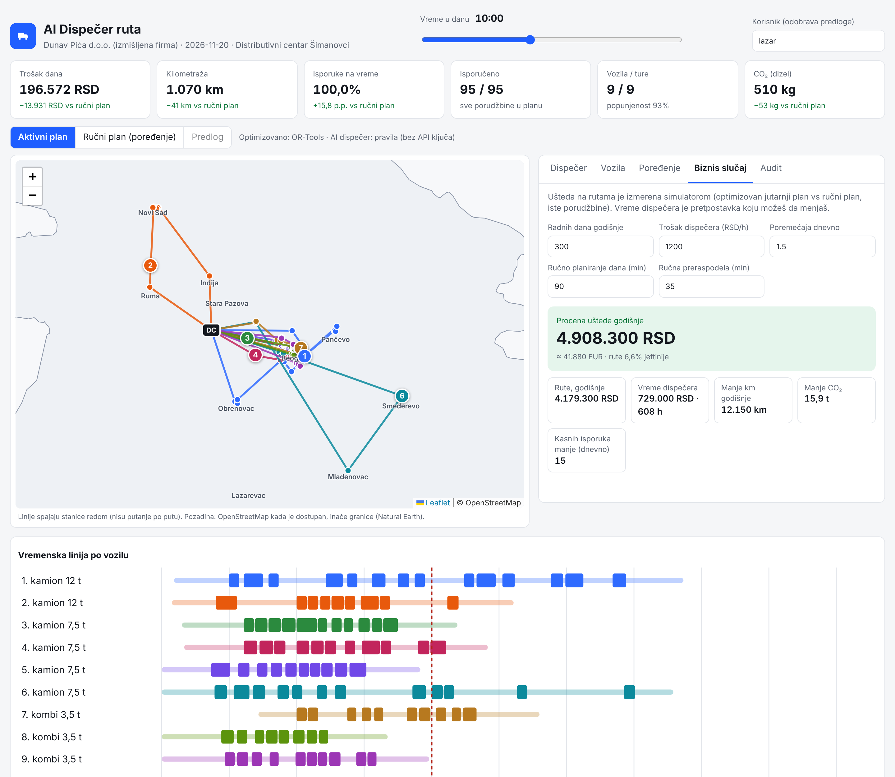

# AI Route Dispatcher: route optimization and AI dispatching for beverage distribution

A daily route planner for a beverage distributor around Belgrade, built on **Google OR-Tools**, with an
**AI dispatcher** on top. The optimizer plans 9 trucks and vans for ~95 deliveries under real constraints
(weight and pallet capacity, returnable empties, customer time windows, central-Belgrade truck restrictions,
shifts, costs). When something goes wrong during the day, the dispatcher writes it in Serbian, for example
*"Kamion 1 je u kvaru, preraspodeli"*, and gets a new plan in seconds: who takes over which stops, who will be late
and by how much, and what it costs. A person approves every change, and every step goes to a tamper-evident audit
log.



## Why this problem

Beverage and FMCG distributors re-plan routes every morning and again whenever a truck breaks down, a customer
cancels or a key account calls with an urgent order. The constraints are tight: cafés accept deliveries only before
they open, supermarkets only at the ramp early in the morning, heavy trucks are not allowed in central Belgrade, and
empty crates and kegs come back on the same truck. Planning by territory is fast but leaves money and punctuality on
the table, and re-planning by phone at 10:30 is where most mistakes happen.

## What it does

| Step | How | Who decides |
|---|---|---|
| Plan the day | OR-Tools CVRPTW: heterogeneous fleet, kg + pallet capacity with pickups of empties, time windows, access zones, shifts, cost per km / crew hour / vehicle | optimizer |
| Check the plan | one simulator recomputes every time, load, cost and violation (`plan.evaluate`) | system |
| Understand a disruption | AI dispatcher (Gemini or Claude) with tools, or a rule parser without a key | LLM / rules |
| Re-plan | before departure: full re-solve with a stability penalty; during the day: done stays done, loaded trucks keep their goods, open work goes to second trips, soft windows | optimizer |
| Explain | diff (moved stops, late stops, not possible today, cost delta) and an explanation built only from those numbers | LLM / template |
| Apply | proposal waits for a named person; agents are refused; stale proposals are refused | **person** |
| Audit | SHA-256 hash chain over every event | system |

## Architecture



Design decisions and the reasons behind them are in [DECISIONS.md](DECISIONS.md).

## Results

Measured with `dispatcher eval` (8 synthetic delivery days, 10 s solver limit). Full report:
[docs/eval_report.md](docs/eval_report.md).

| Metric (8 synthetic days) | Territory baseline | OR-Tools plan |
|---|---|---|
| Daily cost, mean saving | | **12.1% lower** (5.5% to 17.7%), about 28,000 RSD per day |
| Kilometres per day | | 134 km fewer |
| Crew hours per day | | 8.6 h fewer |
| Late deliveries per day | 23 | **0** |
| Plans with hard constraint violations | | 0 |

| Disruptions (32 scenarios) | Result |
|---|---|
| Open stops of a broken vehicle delivered the same day | **93.8%** (39.8% also within the window, the rest late with a known delay) |
| Urgent orders placed | 8 of 8 |
| Re-planning time | about 5 s (solver time limit) |
| Serbian commands understood: rule parser (no AI) | 66.7% of 33 |
| Serbian commands understood: AI dispatcher (Gemini 3.5 Flash Lite, free tier) | **93.9%** of 33, median 4.7 s per command ([details](docs/eval_commands.md)) |

The baseline is a dispatcher-style heuristic (territories by direction, nearest neighbour, everyone leaves at
06:00), and the data is synthetic. The numbers show the optimizer and re-planner work as designed; the saving for a
real company needs its own historical plans.

| Breakdown proposal | Plan comparison | Business case |
|---|---|---|
|  |  |  |

## Quick start

```bash
pip install -e ".[dev]"
dispatcher seed                         # generate a delivery day, plan it (baseline + OR-Tools)
dispatcher ask "Kamion 1 je u kvaru" --clock 10:00
dispatcher eval                         # evaluation report -> docs/eval_report.md
cd web && npm install && npm run build && cd ..
dispatcher serve                        # http://127.0.0.1:8000
```

AI dispatcher: set a free Gemini key (Google AI Studio) or an Anthropic key. Without a key the rule parser is used.

```bash
export GEMINI_API_KEY=...               # or ANTHROPIC_API_KEY=...; LLM_PROVIDER=gemini|anthropic to choose
dispatcher ask "dvojka je stala kod Inđije u 9:40, preraspodeli"
dispatcher eval --llm --commands-only   # only the 33-command test (a few minutes) -> docs/eval_commands.md
dispatcher eval --llm                   # full report including the command test
```

On Windows PowerShell, set the key with `$env:GEMINI_API_KEY = "..."`. The free Gemini tier allows only a few
requests per minute; the client waits and retries on HTTP 429, so the command test can take several minutes.

Docker: `cp .env.example .env && docker compose up --build`, then open http://localhost:8000.

Road distances: by default straight-line distance x 1.32 with a speed profile. For real road distances run an OSRM
server with the Serbia extract from OpenStreetMap and set `DISTANCE_PROVIDER=osrm` and `OSRM_URL`.

## Project layout

```
dispatcher/
  domain.py     depot, vehicles, customers, orders, access rules
  data.py       synthetic customer base and daily orders (fictional company, real towns)
  geo.py        distance/time matrix (approximation or OSRM)
  solver.py     OR-Tools model, second trips
  baseline.py   territory + nearest-neighbour heuristic
  plan.py       simulator: times, loads, costs, violations, vehicle positions
  replan.py     pre-departure and intraday re-planning, plan diff
  explain.py    Serbian explanation from the diff
  agent/        rule parser, LLM tool loop (Claude / Gemini)
  service.py    proposals, approval rules, customer search
  store.py      SQLite plan versions, proposals, audit chain
  api.py        FastAPI (REST + dashboard)
  roi.py        business case
  eval/         evaluation runner and the 33 test commands
web/            React + TypeScript + Leaflet dashboard (Vite)
tests/          31 tests, including the LLM loops with scripted fake models
```

## Limitations and next steps

- Distances are approximate until OSRM (or a traffic-aware matrix) is connected; there is no rush-hour model.
- Driver breaks (EU/Serbian rules on driving time) are not modelled; the 10 h shift limit is.
- Positions during the day come from the plan, not GPS; a driver app with delivery confirmations is the next step.
- AI dispatcher accuracy is measured on 33 hand-written commands with one model (Gemini 3.5 Flash Lite); a breakdown
  time equal to the current clock counts as "now" (strict match: 78.8%). Claude has only been tested with scripted
  fake models.
- Demo authentication is a user name in a header; production needs SSO and roles.

## Role

Lazar Mihajlović: project owner (problem, scope, goals, design decisions). Built with AI assistance (Claude as the
builder). See [DECISIONS.md](DECISIONS.md) and the interview guide in [docs/VODIC_ZA_INTERVJU.md](docs/VODIC_ZA_INTERVJU.md).
